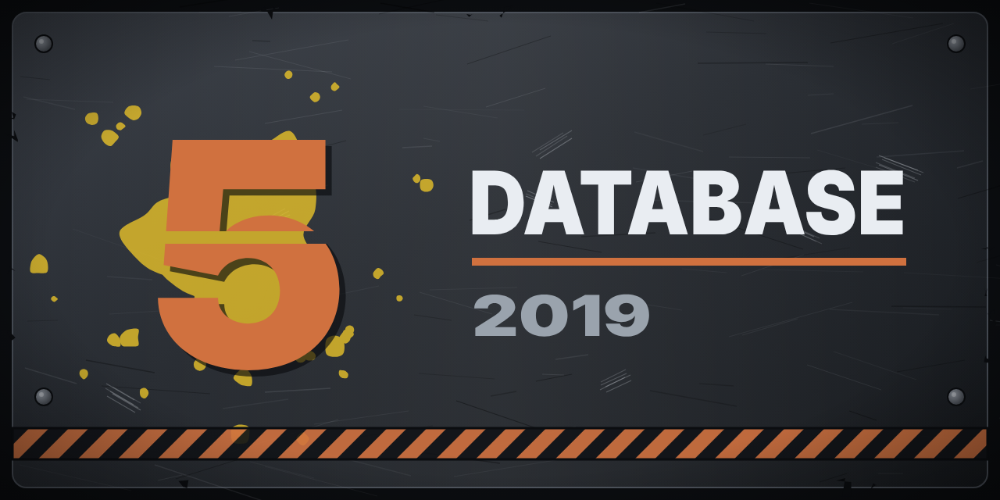

<p align="center">
  
</p>
<p align="center">
  
</p>

# GoW5DB - Gears 5 Database

A fan-made Jekyll site with a complete Gears 5 reference: characters, weapons,
classes, marks, maps, gamemodes, the Fabricator, enemies, banners,
bloodsprays, executions, expressions, esports, bundles, DLC, and Iron. Not
affiliated with The Coalition or Xbox Game Studios.

Live site: <https://thescrewedsoftware.github.io/GoW5DB/>, built and deployed
automatically to GitHub Pages on every push to `main` (see
`.github/workflows/deploy.yml`). Many things are still to be finished and
polished. E-Day is coming soon: see
[GearsOfWarDatabases](https://github.com/orgs/GearsOfWarDatabases/repositories).

Made by: Xbox [MissJamball#7618](https://www.xbox.com/play/user/MissJamball7618) /
GitHub [Ryan Turner (TheSCREWEDSoftware)](https://github.com/TheSCREWEDSoftware).

## Running it locally

Requires Ruby (the deploy workflow uses 3.3, so that's the safest version to
match locally) and Bundler.

```bash
bundle install
bundle exec jekyll serve
```

Then open `http://localhost:4000`. Jekyll watches the source files and
rebuilds automatically on save - just refresh the browser.

On Windows, `ref/start-jekyll.bat` (in the reference submodule) does the same
and also fills in the revision line in the header's top left corner (see
[Revision line](#revision-line)).

## Project structure

- `_classes/` - one file per Horde/Escape class (see
  `HOW-TO-ADD-A-CLASS.md` for the full field reference and examples).
- `_data/` - YAML data backing the site: card costs, perk costs, gamemodes,
  the Fabricator's prices, and more.
- `_includes/` - shared partials (header, footer, description rendering,
  etc.) reused across layouts and pages.
- `_layouts/` - page templates (`default`, `class`, `section`).
- `_sass/` / `styles/` - site styling (SCSS, compiled to compressed CSS via
  `_config.yml`'s `sass` settings).
- `images/` - all art assets, organized by section (weapons, cards,
  abilities, characters, classes/icons, perks, etc.) - each has its own
  `README.md` describing expected filenames.
- Everything else at the root (`characters/`, `weapons/`, `classes/`,
  `marks/`, `maps/`, `gamemodes/`, `fabricator/`, `enemies/`, `banners/`,
  `bloodsprays/`, `executions/`, `expressions/`, `esports/`, `bundles/`,
  `dlc/`, `iron/`, `tools/`) is one folder per site section, each with its
  own `index.html` that reads from `_data/` and/or the `classes` collection.
- `tools/` - interactive pages (Build Creator, Build Viewer, Class
  Randomizer, Weapon Randomizer, and the Map Creator in `map-calibrator/`) -
  vanilla JS, no build step of their own.
- `guides/` - guides (coming soon).
- `ref/` - the reference screenshots and the scripts that sort them, kept in
  their own repository,
  [GoW5DB-Reference](https://github.com/GearsOfWarDatabases/GoW5DB-Reference),
  included here as a git submodule. The site doesn't need it to build (it is
  excluded in `_config.yml`, and the deploy workflow doesn't fetch it). To get
  it: `git clone --recurse-submodules` this repository, or
  `git submodule update --init` in an existing clone.

## Adding content

- **New class**: see `HOW-TO-ADD-A-CLASS.md` - copy an existing
  `_classes/*.md` file and follow the field guide.
- **Everything else** (weapons, cards, gamemodes, marks, etc.): edit the
  relevant file under `_data/`, following the shape of existing entries in
  that same file.
- **A section that isn't ready**: `coming_soon: true` in its page's front
  matter greys it out in the menu and on the home page with a "Coming soon"
  tip.
- **Site-wide texts** (tagline, the work in progress note and its TODO link,
  the credits, the E-Day notice): `_config.yml`.

## Revision line

The site shows which commit it was built from (hash, date, branch, OS):

- On GitHub Pages, centered in the footer: "Hosted on GitHub Pages." and the
  revision, the hash linking to the commit.
- In local and self-hosted builds, in the header's top left corner, with the
  server's uptime.

`_plugins/last_commit.rb` tells them apart by the `GITHUB_ACTIONS` variable
that GitHub Actions sets.

## Deployment

Push to `main` and the `Deploy to GitHub Pages` workflow builds the site
with Jekyll and publishes it - no manual deploy step needed.

## License

Copyright (C) 2026 [Ryan Turner (TheSCREWEDSoftware)](https://github.com/TheSCREWEDSoftware) and the GoW5DB
contributors.

The site's code (templates, styles, scripts, tools and data files written for
it) is free software: you can redistribute it and/or modify it under the terms
of the GNU Affero General Public License as published by the Free Software
Foundation, either version 3 of the License, or (at your option) any later
version. See [LICENSE](LICENSE).

Gears 5, its names, images and other game content belong to Microsoft and The
Coalition. They are used here for reference in a non-commercial fan project and
are not covered by this license.
